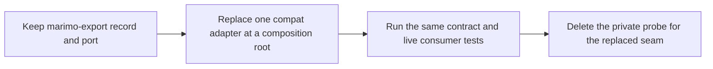

# Proposal: marimo upstream capabilities

| Field                            | Value                                                                                                                                                                          |
| -------------------------------- | ------------------------------------------------------------------------------------------------------------------------------------------------------------------------------ |
| Status                           | Proposed                                                                                                                                                                       |
| Date                             | 2026-10-25                                                                                                                                                                     |
| Owner repository                 | `marimo-team/marimo` for supported upstream APIs, `marimo-team/marimo-export` for adapter replacement                                                                          |
| Inspected marimo-export revision | `9d0aba57d80b83dcfe8ac7efd15bff7a29492d66`                                                                                                                                     |
| Inspected marimo revisions       | Release 0.25.2 (`b0e402345e0a0c0731e745c8e1183ef0840804b2`) and `main` at `a61726dcda47` (2026-10-24)                                                                          |
| Supported marimo release         | Recorded in [`packages/python/pyproject.toml`](../../packages/python/pyproject.toml) and [`release.json`](../../packages/python/src/marimo_export/_marimo/compat/release.json) |

This proposal records possible supported marimo APIs that could replace private
compatibility adapters. An API listed here exists in marimo only where its
status says so.

marimo-export targets the published marimo release recorded by its package and
compatibility metadata through local ports and private compatibility adapters.
Each candidate on this page names a public marimo capability that could replace
one contained adapter while preserving the marimo-export service contract.

A **marimo seam** subsection cites the private marimo code at both inspected
revisions. Paths are relative to the marimo repository, and one line number
means the two revisions agree.

The migration rule is:



Changes to an upstream interface should preserve marimo's cache keys, stores,
serialization, signing, restoration, graph execution, and session lifecycle.

## Candidate map

| Candidate                          | Current adapter                                     | Stable marimo-export boundary          | Status                                   |
| ---------------------------------- | --------------------------------------------------- | -------------------------------------- | ---------------------------------------- |
| Cached child execution             | cache patch, child runner, execution adapter        | `CachedStateExecutor`                  | Proposed                                 |
| Final cache disposition            | graph-scoped attempt wrapper                        | `CacheActivity`                        | Proposed                                 |
| Forced live execution              | graph-scoped hit replacement                        | executor policy for selected cells     | Proposed                                 |
| Sequential lazy deserialization    | `SequentialLazyLoader` in the `lazy` registry slot  | verified native return                 | Proposed, entry point on `main`          |
| Producer cache key input           | AST reference and Arrow digest retry                | producer environment digest            | Proposed, Arrow part in 0.25.2           |
| Native cache write barrier         | `flush_active_caches` adapter                       | executor run boundary                  | Proposed                                 |
| Verified cached return             | private manifest, store, signing, and codec adapter | `NativeCacheReturn`                    | Proposed, verification changed on `main` |
| Complete cached UI restoration     | `CompleteCachedLifecycle`                           | state execution success                | Proposed, partly covered on `main`       |
| Interactive host cache restoration | UI, Polars, and tensor host patch                   | `keep_cached_cells_compatible()`       | Proposed                                 |
| Deterministic child release        | weak-reference finalizer extraction                 | state child cleanup                    | Proposed                                 |
| Managed runtime filename           | `SessionImpl.create` patch                          | `OwnedNotebook` runtime filename       | Proposed                                 |
| UI element introspection           | private `UIElement` fields and `on_change` wrapper  | control trees and `ControlBinding`     | Proposed                                 |
| Successful-run observation hook    | private final runner hook                           | `KernelRun` and `NotebookCell` records | Proposed                                 |
| Canonical rendered snapshots       | output hooks, `SessionView`, and UI registries      | output receipt and replay records      | Proposed                                 |
| Host protocol transport            | hidden scratchpad and session routes                | `HttpKernelTransport`, `ManagedServer` | Lifecycle proposed, bridge speculative   |

## Cached child execution

### Required behavior

An integration consumer creates a child graph, runs a selected topological
closure through native cached execution, receives final hit or miss decisions,
flushes writes, and closes the child deterministically.

The capability needs to support:

- selected cells that must execute live for one run
- native handling for every other cell
- one final disposition per executed cell
- UI definitions that require live registration after cache restoration
- unavailable cached values that must rerun
- explicit flush before dependent work
- cleanup after success, failure, and cancellation

### Current implementation

`_marimo/compat/cache/patch.py`, `_marimo/compat/cache/attempts.py`,
`_marimo/compat/cache/lifecycle.py`, `_marimo/compat/child_run.py`, and
`_marimo/compat/execution.py` implement this behavior against private marimo
objects. `_marimo/capabilities.py` exposes `CachedStateExecutor` and
`StateExecution` to the service side. The candidates below split this behavior
into seams that can move upstream one at a time.

### Upstream shape

A marimo context-managed cached child session could expose:

```python
class CachedChildSession(Protocol):
    async def run(
        self,
        cell_ids: Collection[CellId],
        *,
        force_live: Collection[CellId] = (),
    ) -> tuple[CellCacheReceipt, ...]: ...

    def flush(self) -> None: ...
```

The composition root would adapt those receipts to `CacheActivity` and
`StateExecution`. Planning, repository, preparation, and export records would
remain unchanged.

## Final cache disposition and forced live execution

### Required behavior

marimo-export needs the final decision after native cache validity checks and
unavailable-value handling. It also needs to request a live run for
complete-cell owners and exporter leaves whose contracts include uncached
side effects or current process resources.

### Current implementation

`cache_attempt_from_hash` is wrapped once. Active scopes are keyed by exact
graph identity. The wrapper records the effective disposition and replaces a
selected hit with an empty native attempt.

### marimo seam

`CachedLifecycle.setup` calls the module-level `cache_attempt_from_hash`
(`marimo/_runtime/executor/lifecycles/cached.py:147`) and reports no
disposition to the caller. The release probe pins the source digests of both
symbols.

### Upstream shape

A run request could accept `force_live` cell IDs and return a typed disposition
for each cell. `ExecutionPlan.live_cells` holds authored owner cell IDs, which
the adapter resolves through `StateChild.cell_ids`. `ExecutionPlan.live_outputs`
holds output names, which it resolves through `StateChild.output_cell_ids`. The
union of those runtime IDs is the set the adapter hands to `force_cache_misses`
today. A forced cell must still save its result under its native key, because
output receipts read that entry back. marimo would retain ownership of cache
attempt construction, key semantics, and authored-cell invalidation.

The local `CacheActivity` record remains the consumer contract. The global
attempt-function patch and its source digest can then leave the adapter.

## Sequential lazy deserialization

### Required behavior

Some output codecs must deserialize on the kernel thread. Signature precedence,
missing blobs, unreadable blobs, store selection, and value restoration must
match native lazy loading.

### Current implementation

`SequentialLazyLoader` in `_marimo/compat/cache/loader.py` reproduces the
control flow of marimo's private `LazyLoader._read_blobs` and invokes marimo's
store, signer, and deserializer. `_marimo/compat/cache/patch.py` installs it by
replacing `PERSISTENT_LOADERS["lazy"]` with a `DualLoader` whose native entry
is `SequentialLazyLoader`, inside the same reference-counted lease that
replaces `CachedLifecycle` and `cache_attempt_from_hash`. The release probe
pins the `_read_blobs` source digest and checks the `lazy` registry entry.

### marimo seam

`CachedLifecycle.__init__` builds its loader from `PERSISTENT_LOADERS[loader]`
with the default key `"lazy"`
(`marimo/_runtime/executor/lifecycles/cached.py:122-134`). The cell runner
constructs it without a loader argument
(`marimo/_runtime/runner/cell_runner.py:206-213` on 0.25.2, `:207-214` on
`main`). `main` adds the script runner as a second caller with the same call
(`marimo/_runtime/app/script_runner.py:310`).

`main` adds three pieces that 0.25.2 lacks:

- the `marimo.cache.loader` entry-point group
  (`marimo/_entrypoints/ids.py:10`)
- `get_persistent_loader(key)`, which resolves a built-in name or an allowed
  entry point (`marimo/_save/loaders/__init__.py:78`)
- `get_loader_key(config=...)`, which reads `cache.loader` from a kernel's
  effective config (`marimo/_save/loaders/__init__.py:133`)

On `main`, `cache.loader` selects the default method for `mo.persistent_cache`
(`marimo/_config/config.py:624-634`,
`marimo/_runtime/context/kernel_context.py:205-211`).
The cell cache still constructs the `lazy` loader.

### Upstream shape

Step one lets the cell cache resolve its loader through the same entry-point
registry, from a cell-cache key of its own:

```python
# marimo/_runtime/runner/cell_runner.py
CachedLifecycle(
    self.graph,
    pin_modules=bool(user_config.get("runtime", {}).get("pin_modules", True)),
    loader=user_config.get("cache", {}).get("cell_loader", "lazy"),
)

# marimo/_runtime/executor/lifecycles/cached.py
self._loader = get_persistent_loader(loader)(name="cell_cache")
```

Reusing `cache.loader` would change cell caching for every user who set it for
`mo.persistent_cache`, such as `cache.loader = "pickle"`. Embedded contexts
also inherit the parent's `cache.loader`
(`marimo/_runtime/context/kernel_context.py:205-211` on `main`), so one
`cache.loader` value would resolve to two loaders inside a state child: the
child's for the cell cache and the parent's for `mo.persistent_cache`. A
separate key keeps each setting to one meaning. `get_persistent_loader` checks
for a `Loader` subclass, while `CachedLifecycle` calls `mark_stale` and relies
on the store-backed paths of `BasePersistenceLoader`
(`marimo/_runtime/executor/lifecycles/cached.py:359` on `main`), so the
cell-cache path needs that narrower check.

marimo-export would register `SequentialLazyLoader` under
`marimo.cache.loader` in `packages/python/pyproject.toml` and set the key in the
child kernel config that `open_state_child` already writes for
`runtime.cache_cells`. Notebook script metadata cannot carry a loader. On
`main`, #11403 lists `("cache", "loader")` in `_UNTRUSTED_MARIMO_KEYS`
(`marimo/_config/reader.py:149-153`), which strips it from every config layer
that travels with code, and `ALLOWED_SCRIPT_CONFIG_TOP_KEYS` omits `cache`
(`marimo/_config/reader.py:88-104`). A new cell-cache key needs the same trust
rule. The owned parent kernel would then need user config or a new override
channel. Before asking for one, confirm
whether the parent needs the sequential loader at all, since output leaves run
only in state children.

Step two makes deserialization placement a supported loader option, so
marimo-export can select kernel-thread execution without overriding
`_read_blobs`.

### Status

Proposed. Step one deletes `_sequential_loader_entry`, the
`PERSISTENT_LOADERS["lazy"]` replacement in `_marimo/compat/cache/patch.py`, and
the probe's `PERSISTENT_LOADERS.lazy` check. Step two deletes the
`SequentialLazyLoader._read_blobs` override and its pinned digest.

## Producer cache key input

### Required behavior

Every owned graph's native cache key must include the producer environment
digest, so a changed dependency closure misses even when cell code and
`__version__` stay constant. A cell that references a PyArrow value must hash
deterministically.

### Current implementation

`cache_attempt_wrapper` in `_marimo/compat/cache/attempts.py` receives the
digest from `environment_identity()` through `track_notebook_cache` and
`track_managed_parent_cache`. `_with_environment` appends a reference to a
fresh name to a copy of the cell AST and binds the digest in the hashing scope.
Authored execution keeps its original module and scope. When the native attempt
raises `TypeError`, `_with_arrow_digests` retries with a digest of the type and
Arrow IPC stream of each referenced PyArrow value.

### marimo seam

`cache_attempt_from_hash` (`marimo/_save/hash.py:1170`) takes the cell module,
graph, cell ID, scope, and loader. It has no input that applies to every cell of
one graph.

marimo #11084 is part of 0.25.2. `is_data_primitive`
(`marimo/_runtime/primitives.py:79-89`) content-hashes an Arrow value whose
columns are all integer or floating types and hashes any other Arrow value by
execution path. On 0.25.2, `cache_attempt_from_hash` keys a table with a string
or dictionary column, an integer column with nulls, and a chunked array without
raising `TypeError`.

### Upstream shape

```python
class CachedLifecycle:
    def __init__(
        self,
        graph: DirectedGraph,
        pin_modules: bool = True,
        loader: str = "lazy",
        key_inputs: Mapping[str, bytes] = MappingProxyType({}),
    ) -> None: ...
```

`CachedLifecycle` would pass `key_inputs` to every `cache_attempt_from_hash`
call, which mixes each name and value into the block hash. The owned parent
kernel and each state child need a supported way to supply the mapping for their
graph.

### Status

Proposed for the key input. It deletes `_with_environment` and the
`environment` field of the graph scope. The Arrow half needs no upstream API.
`_with_arrow_digests` and `_arrow_digest` can go once the live PyArrow build
test passes with the retry disabled.

## Native cache write barrier

### Required behavior

Background lazy-cache writes must be visible before a dependent state hashes or
before output receipt extraction reads the native store.

### Current implementation

`_marimo/compat/cache/barrier.py` registers one early post-execution hook and
delegates flush to marimo's private `flush_active_caches()`.

### Upstream shape

A cached execution session should expose `flush()` or guarantee that run
completion includes pending writes. The marimo-export executor keeps the call
at the same state and receipt boundaries.

## Verified cached return

### Required behavior

For one output cell, marimo-export needs a stable verified view of:

- the final native manifest hash
- an inline scalar and its Python type
- or one verified NumPy, Arrow, or BlobAsset payload

### Current implementation

`_marimo/compat/cache/receipts.py` snapshots reads from the selected store,
decodes marimo's private cache schema, resolves the effective signer through
`LazyLoader._effective_verification` and `LazyLoader._resolve_effective_signer`,
verifies the selected blob, and returns `NativeCacheReturn`.
`_marimo/compat/cache/probe.py` and `_marimo/compat/managed_kernel.py` reject an
environment without `cryptography`.

### marimo seam

marimo #11403 rewrote lazy-loader verification on `main`. The default
verification is `off` (`marimo/_save/signing.py:24`), where 0.25.2 defaults to
`on` (`signing.py:25`). Both private methods the receipt adapter calls changed
source (`marimo/_save/loaders/lazy.py:753` and `:1002` on 0.25.2, `:786` and
`:1043` on `main`). With verification `off`, `_resolve_effective_signer`
returns no signer, and the lazy loader works without `cryptography`.

### Upstream shape

marimo could return an immutable verified return receipt from cached execution:

```python
@dataclass(frozen=True)
class VerifiedReturn:
    python_type: str
    value: object | None
    codec: str
    payload: bytes | None
    verification: Literal["off", "on", "strict"]
```

The exact upstream record may retain marimo-native codec types. One compat
adapter maps it to `NativeCacheReturn`. Descriptor and portable asset policy
remain in marimo-export.

### Status

Proposed. A pin past #11403 needs one decision first. With verification `off`,
`_verify_signed_blob` has no signer, and `main` writes empty `blob_hashes` for
unsigned manifests (`marimo/_save/loaders/lazy.py:1473-1475`), so the receipt
adapter would read the return payload with no native integrity check. The
options are:

- set `cache.verification = "on"` for owned kernels and keep the
  `cryptography` checks
- ask marimo to record blob digests for unsigned entries
- digest the return payload in marimo-export before it enters an export

## Complete cached UI restoration

### Required behavior

A cache hit that restores an unavailable `UIElementStub`, `UnhashableStub`, UI
element, or `mo.state` object must execute live before export.

### Current implementation

`CompleteCachedLifecycle` in `_marimo/compat/cache/lifecycle.py` reruns
unavailable hits and recreates session-bound state inside an owned graph scope.
The attempt wrapper detects stubs at any depth of the restored definitions and
return value.

### marimo seam

On both revisions, `CachedLifecycle.setup` runs a hit live when it defines a
live UI element (`_restored_ui_defs`). On `main`, marimo #11369 also runs a hit
live when its restored return value is an unhashable-stub placeholder
(`marimo/_runtime/executor/lifecycles/cached.py:178-183`). That covers a cell
with no definitions whose last expression could not be pickled. Both
revisions also reschedule the definers of a top-level stub when a consumer
references it (`_preflight_refs` raises `MarimoRescheduleError` at
`cached.py:324` on 0.25.2 and `:344` on `main`). That repair runs on the consumer. An output cell
must rerun its own hit eagerly, and stubs inside definitions or nested in
containers, and restored `mo.state` objects, still need the local lifecycle.

### Upstream shape

marimo could define cached lifecycle completeness as a native post-restore
contract and report final execution disposition through the cached execution
receipt. The local lifecycle subclass can then be replaced behind
`CachedStateExecutor`.

## Interactive host cache restoration

### Required behavior

An interactive host must restore cached composite UI values, load Polars values
through a compatible serializer, and produce contiguous bytes for Polars tensor
encoding. The capability needs a reversible lifecycle that composes with other
cached execution owners.

### Current implementation

`_marimo/compat/cache/host.py` owns one reference-counted lease over the
private restored-UI check and tensor byte encoder. marimo owns Polars Arrow IPC
serialization. A host acquires the lease through
`marimo_export.integration.keep_cached_cells_compatible()`.

### Upstream shape

marimo could make composite UI discovery and tensor serialization native cache
behavior. The host integration call can remain as a
capability check until every supported marimo release provides those semantics,
then the composition root can return an idempotent empty release handle.

## Deterministic child release

### Required behavior

A state child detaches its runtime context from the parent kernel context after
success, failure, or cancellation, before the next state starts. The parent must
stop listing the child context once release returns.

### Current implementation

`release_state_child` in `_marimo/compat/child_run.py` scans
`weakref.getweakrefs(child)` for the `weakref.finalize` entry that
`AppKernelRunner` registered. It accepts the entry only when it calls the parent
context's `remove_child` with the child context, detaches it, and calls it. It
raises when the finalizer is missing or the parent still lists the child.

### marimo seam

`AppKernelRunner.__init__` registers
`weakref.finalize(self, ctx.remove_child, self._runtime_context)` with
`atexit` disabled (`marimo/_runtime/app/kernel_runner.py:150-153`). The class
has no `close()` method or context manager.

### Upstream shape

```python
class AppKernelRunner:
    def close(self) -> None: ...  # idempotent, detaches the finalizer
    def __enter__(self) -> Self: ...
    def __exit__(self, *exc_info: object) -> None: ...
```

### Status

Proposed. It deletes `release_state_child` and its finalizer matching.
`own_state_child` keeps its cleanup order: close the recording, flush native
writes, then close the runner.

## Managed runtime filename

### Required behavior

The managed server serves a sibling copy of the notebook, while the kernel's
`app_metadata.filename` names the authored notebook. That filename selects
marimo's cache store, and the observation and environment adapters read it as
the notebook path.

### Current implementation

`_marimo/compat/managed_server.py` reads `MARIMO_EXPORT_MANAGED_SOURCE` and
`MARIMO_EXPORT_MANAGED_SNAPSHOT`, replaces `SessionImpl.create` with a
classmethod that rewrites `app_metadata.filename` from the snapshot path to the
source path, then calls marimo's CLI entry point.

### marimo seam

`SessionImpl.create` (`marimo/_session/session.py:92`) receives the
`AppMetadata` that `marimo edit` builds from the served file. `marimo edit` has
no option that separates the runtime filename from the served file.

### Upstream shape

```text
marimo edit <snapshot.py> --runtime-filename <notebook.py>
```

### Status

Proposed. It deletes the `SessionImpl.create` patch and both environment
variables. `_marimo/managed_server.py` would start `marimo edit` directly.

## UI element introspection

### Required behavior

Planning, live input observation, and state execution read each UI element's
frontend value, its child elements with typed path steps, and its component
kind and arguments. State execution applies values and fails the state when an
`on_change` handler raises.

### Current implementation

`_marimo/compat/inspection.py` reads `UIElement._value_frontend` in
`_frontend_value`, reads `_component_args` in `_component_kind`,
`_control_domain`, and `_binding_domain`, and walks the `element` and
`elements` attributes into `ControlElementStep`, `ControlKeyStep`, and
`ControlIndexStep` paths in `_control_tree_entries`.
`_marimo/compat/execution.py` applies values through
`AppKernelRunner.set_ui_element_value` and wraps each element's private
`_on_change` in `_capture_ui_callback_errors` to raise `input_value_invalid`.

### marimo seam

`UIElement` stores `_value_frontend`, `_on_change`, and `_component_args` as
private fields (`marimo/_plugins/ui/_core/ui_element.py:273-276`), and
`UIElement._update` calls `_on_change` (`ui_element.py:460-470`).
`Kernel.set_ui_element_value` catches an `on_change` exception, writes its
traceback to stderr, and continues (`marimo/_runtime/runtime.py:2124` on 0.25.2,
`:2141` on `main`).

### Upstream shape

```python
@dataclass(frozen=True)
class UIElementDescription:
    object_id: str
    kind: str | None
    args: Mapping[str, JSONType]
    frontend_value: JSONType
    children: tuple[tuple[UIPathStep, UIElementDescription], ...]


def describe_ui_element(element: UIElement[Any, Any]) -> UIElementDescription: ...


@dataclass(frozen=True)
class UIUpdateResult:
    applied: bool
    errors: Mapping[str, BaseException]  # by object ID


async def set_ui_element_value(
    request: UpdateUIElementCommand,
    *,
    notify_frontend: bool,
) -> UIUpdateResult: ...
```

Formatting a value within a cell scope belongs to the same family. It is
recorded under [Canonical rendered snapshots](#canonical-rendered-snapshots).

### Status

Proposed. It deletes the private field reads and the `_on_change` wrapper.
`_control_tree_entries` would build `ControlBinding` paths from the described
children.

## Successful-run observation hook

### Required behavior

An application can subscribe to successful normal notebook runs and receive a
callback after final cell state is stable. The callback must distinguish scratch
execution, interruption, cancellation, and exceptions.

### Current implementation

`_marimo/compat/observations.py` implements the run subscription. It registers
one final runner callback per kernel and multiplexes subscriptions behind it,
because marimo hooks can be added but never removed.
`_marimo/compat/inspection.py` implements the saved-notebook parser.

```python
# _marimo/compat/observations.py
subscribe_run_finished(context, callback: Callable[[KernelRun], None]) -> release
kernel_filename(context) -> str | None

# _marimo/compat/inspection.py
saved_cells(notebook, source) -> tuple[NotebookCell, ...]
```

`KernelRun` in `_marimo/capabilities.py` describes one pass of the cell runner.
It carries the outcome (`completed`, `interrupted`, or `failed`, where `failed`
includes `mo.stop`), a scratch flag, the filename the kernel reports,
`read_cells()` for the kernel graph as `KernelCell` rows, and `read_inputs()` for
the portable UI inputs. `saved_cells` parses a saved notebook into
`NotebookCell` rows for both the document digest and observation matching.

`_observations/runs.py` records completed non-scratch passes whose filename
resolves to the ledger source. `_observations/source.py` compares a cell
signature of the live graph with the saved cells and resolves producer identity
on the ledger worker.

### marimo seam

`NotebookCellHooks.add_on_finish` (`marimo/_runtime/runner/hooks.py:141`)
appends a callback and has no matching removal.

### Upstream shape

A supported run-finished subscription that returns a release handle would
replace the compat implementation of `subscribe_run_finished` and its
multiplexer. The composition-root function keeps its signature.
It needs to report the outcome, scratch flag, notebook filename, graph cells,
and a way to read UI inputs while the final state is stable. `_observations`
would keep consuming `KernelRun` for its success filter, source binding,
saved-cell matching, queueing, revisions, and repository persistence.

marimo reports completed runs per command cycle with a run ID, and one cycle
can contain several runner passes when cells set `mo.state`. A cycle-level
subscription would record a cycle's final state only, so the adapter needs to
choose one granularity and keep `failed` covering `mo.stop`.

## Canonical rendered snapshots

### Required behavior

Rendered-output and complete-cell projections need one final immutable record
that includes output, console, run status, UI values, virtual files, public
files, AnyWidget model closure, and function namespaces.

### Current implementation

The projection adapter installs private output hooks, records through
`SessionView`, rewrites scoped identities, closes reachable resources, and
serializes package-owned replay records. Rendered-output formatting enters the
child's private kernel runtime context through `install()`, `with_cell_id()`,
and `provide_ui_ids()` in `_marimo/compat/projections.py`. Formatter-created UI
elements, such as a dataframe's table, then register under the owner cell with
projection-scoped IDs.

### marimo seam

`with_cell_id` and `provide_ui_ids` are methods of the private kernel runtime
context (`marimo/_runtime/context/kernel_context.py:128` and `:108`), and
`install()` belongs to its base class (`marimo/_runtime/context/types.py:188`).

### Upstream shape

marimo could expose a supported snapshot API for one cell or output owner after
a run reaches final state. The snapshot should carry native ownership and
cleanup rules for files, models, and functions. A supported way to format a
value within a cell scope, with caller-chosen UI ID prefixes, replaces the
three runtime-context calls.

marimo-export would continue to select outputs, bind them to state and producer
identity, enforce portable limits, and write the durable export format.

## Host protocol transport

The protocol on `main` covers the managed-session lifecycle. Bridge operations,
in capture and in managed sessions, are speculative and need a spike.

### Current implementation

`capture` posts bridge code to marimo's scratchpad route `/api/kernel/execute`
(`_remote/client.py:282`) and reads its server-sent events. `ManagedServer`
polls `/api/sessions` for readiness, follows `/sse` for `kernel-ready` and
`completed-run`, and drives `/api/kernel/instantiate`, `/api/kernel/run`, and
`/api/kernel/shutdown` (`_remote/managed.py`).

### marimo seam

marimo registers both routes with `include_in_schema=False`
(`marimo/_server/api/endpoints/execution.py:311` and
`marimo/_server/api/endpoints/health.py:105` on 0.25.2, `:306` and `:106` on
`main`). Host protocol v1 (`protocols/host/openapi.yaml`) serves under
`/api/marimo/v1` (`marimo/_server/host/__init__.py:4`). 0.25.2 mounts it only
when `MARIMO_ENABLE_HOST` is set (`marimo/_config/settings.py:19`,
`marimo/_server/main.py:64`). `main` mounts it unconditionally after marimo
#11355 (`marimo/_server/main.py:63-66`).

The protocol's `runtime.run` operation (`protocols/host/openapi.yaml:500` on
`main`) "Runs `code` in a copy of the notebook runtime's namespace, or runs
`cells` of the document". The 0.25.2 spec already declares the `cells` form,
but its host backend runs scratch code only. marimo #11429 implements cell runs
after 0.25.2. The operation allows one run at a time and answers
`conflict` while another run is in progress. On `main`, marimo's host backend
implements scratch runs with the same `ExecuteScratchpadCommand` that
`/api/kernel/execute` submits, after an instantiate request without autorun
(`marimo/_server/host/backend.py:242-264`).

marimo #11378 on `main` also serves host events on `/sse`. Kernel
notifications arrive as `event: marimo` with `{"marimo": {"op": ..., ...}}`
data and no `data` member, beside notebook and cell model events
(`marimo/_server/host/events.py:63-73`). `ManagedServer` reads the unframed
0.25.2 shape,
so a pin past #11378 changes its stream parsing whether or not the rest of
this candidate lands.

Version 1 accepts only loopback connections with a bearer token from
configuration or local discovery (`protocols/host/spec.md:236-241`). `connect()` also reaches
remote HTTPS servers with `access_token` and `server_token`, which the host
protocol would not serve.

### Spike question

`runtime.start`, `runtime.run` with `cells`, and `runtime.stop` cover the
lifecycle calls `ManagedServer` makes today: instantiate, run, and shutdown.
Moving them needs a pin to a release that contains #11429. Session creation and
readiness move with them. `ManagedServer` also runs bridge operations such as
`validate_baseline` through the scratchpad route (`_remote/managed.py:175-181`),
and `OwnedNotebook` runs every preparation bridge call through a `Client`
(`producer.py:95-104`). Those calls share the capture question.

For bridge operations, does scratch code submitted through `runtime.run` run in the
kernel's runtime context, so the bridge can call `get_context()`, attach `AppKernelRunner`
children, register virtual files that the server serves, and read the live UI
registry? The protocol text promises a namespace copy, so a supported answer
needs a contract statement in `protocols/host/spec.md` or `openapi.yaml`. The
spike also needs to confirm that the one-run limit and the per-run instantiate
fit a capture that runs while the author keeps editing.

### Status

Proposed for the managed lifecycle, speculative for bridge operations. A pin
past #11429 can move the instantiate, run, shutdown, and readiness calls of
`ManagedServer` to host-protocol calls. A passing spike would move
`HttpKernelTransport` as well and delete the remaining hidden-route requests. Remote capture stays on the current routes while the protocol serves
loopback only.

## Acceptance conditions

Replace a private seam when the supported marimo capability passes the existing
marimo-export tests for:

- cache key and store behavior
- signed and unsigned cache receipts
- missing, corrupt, and unavailable values
- live complete-cell and exporter-leaf execution
- unrelated graph isolation
- write visibility
- state failure atomicity
- observation filtering and source identity
- replay closure and browser fidelity
- cleanup after cancellation and process shutdown

The replacement is complete when `_marimo/composition.py` selects the supported
adapter and the corresponding private source digest and patch code are gone.
