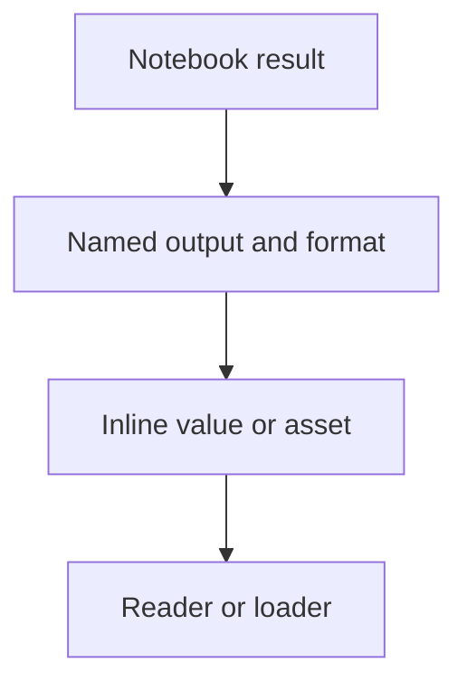

# Outputs

The quickstart computes the same information in two forms:

| Notebook result      | Output name | Stored as                        | Reader receives        |
| -------------------- | ----------- | -------------------------------- | ---------------------- |
| `summary` dictionary | `summary`   | Portable JSON in `index.json`    | Structured data        |
| Rendered `report`    | `report`    | Rendered output in an asset file | Rendered output record |

An **output** is a published name and stored form in every exported state. The
notebook value before publication is a **notebook result**.

The quickstart app reads both outputs from the selected state. `summary` supplies
structured data while `report` supplies the rendered notebook result.

<StaticApp example="quickstart" />



## Choose the notebook value

Each output source chooses what the producer captures:

| Source kind | Selected result                                                          |
| ----------- | ------------------------------------------------------------------------ |
| `json`      | Portable Python value                                                    |
| `native`    | Value supported by [marimo's cache](https://docs.marimo.io/api/caching/) |
| `export`    | Python value converted by an exporter                                    |
| `output`    | Value formatted by marimo                                                |
| `cell`      | Complete named or inspected cell record                                  |

The quickstart uses `json` for `summary` and `output` for `report`. Selected-value
sources begin with a Python definition name and can follow supported attribute or
item steps. A cell source identifies the complete cell.

An `output` or `cell` source keeps marimo UI elements in the rendered output.
A table calls Python to search, page, sort, and summarize rows. Set
[`read_only`](../reference/export-spec#read-only-tables) on its output to keep
an eager table's first page and record each function it cannot call. A lazy
table loads its first page through Python and still fails.

## Each output is captured separately

marimo-export captures each named output separately for every state. This
output-specific capture is called a **projection**.

Separate resource identifiers let a consumer display several outputs together
without collisions.

## A representation tells readers how to decode an output

Each output records a codec and media type. Together they define its
**representation**. The output descriptor also records:

- provenance for the stored Python value
- an inline value or content-addressed asset reference

An exporter can convert a selected Python value into a `BlobAsset` with bytes,
media type, optional filename, and portable metadata. Built-in exporters cover
text, HTML, Parquet, Altair Vega-Lite, AnyWidget, and versioned JSON assets.
The `media` exporter renders figures and charts in the formats a consumer
accepts, such as PDF for a typeset report or SVG for a web page.

## Optional outputs can be unavailable in some states

A required output fails the export when one state cannot produce it. Mark an
output `optional` when some input combinations legitimately have no value:

```python
OutputSpec.export("chart", media(["image/png"]), optional=True)
```

In a state where an optional output has no value, the export records an
**unavailable output** with a reason and a short message in place of a
descriptor:

| Reason                       | Condition in that state                                           |
| ---------------------------- | ----------------------------------------------------------------- |
| `representation_unavailable` | The exporter found none of its accepted media types for the value |
| `value_missing`              | The selector names an attribute or item the value lacks           |
| `stopped`                    | A cell in the output's dependency closure called `mo.stop`        |

Other failures still fail the export, including a missing renderer package, a
value too large for its JSON form, exceptions raised by notebook cells or
exporters for any other reason, transfers, and integrity checks. An
unavailable output references no asset.

## Consumers load, then optionally mount

Python readers use representation-specific accessors such as `json()`,
`asset_bytes()`, and `blob_asset()`. Browser readers load through an explicit
output loader:

```ts
const summary = await state.output("summary").load(jsonLoader());
const report = await state.output("report").load(marimoOutputLoader());
```

Loading verifies the selected asset before decoding it. Loading an unavailable
output fails with `output_unavailable` before any fetch or decode. Check
`output.unavailable` to choose a placeholder instead. The report loader
returns an inert rendered-output snapshot. Other loaders can return a value with
`mount(element)`.

Mounting attaches an interactive value to the document and grants its code the
page's authority. Dispose the mounted view before replacing it or tearing down
the page.

Related: [Reuse](preparation-and-reuse) explains when the
producer creates these outputs. [Output
representations](../reference/representations) lists every source, exporter,
loader, peer dependency, and media contract.
