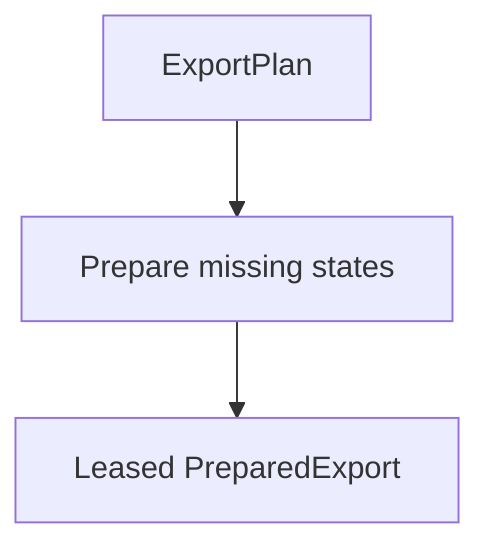

# Reuse

The first quickstart build runs `weekly` and `monthly`. Later builds can reuse
one state's outputs or the complete export when the notebook, output
declarations, and input values still match.

| Change                                         | Reused                  | New work                  |
| ---------------------------------------------- | ----------------------- | ------------------------- |
| Repeat the same `ExportSpec`                   | The complete export     | Nothing                   |
| Add another alias for `weekly`                 | Both states             | Write a new export index  |
| Change the `monthly` input                     | `weekly`                | Run the new monthly state |
| Change an output declaration                   | Nothing from that setup | Run every distinct state  |
| Change notebook source or producer environment | Nothing from that setup | Run every distinct state  |

Adding or removing a state can change every fingerprint when the edit also
changes the inferred input-name set.

## When a state can be reused

Reusing a prepared state requires three matches:

| Must match | Compared value                                             |
| ---------- | ---------------------------------------------------------- |
| Producer   | Notebook source, imported dependencies, and implementation |
| Outputs    | Complete authored `outputs` mapping                        |
| State      | Complete input vector                                      |

A prepared state contains the output descriptors and assets for one matching
combination. A prepared export adds the exact `ExportSpec` identity and assembles
the requested states and aliases into one immutable export generation.

## What the producer environment covers

The producer environment is the code a notebook can import. marimo-export reads
every `import` and `from ... import` statement in the notebook's cells, including
imports inside functions. It resolves each top-level module in this order:

1. The notebook directory.
2. The project's `src` directory, then the project root. The project root is the
   nearest directory at or above the notebook that contains `pyproject.toml`,
   `setup.cfg`, or `.git`.
3. The Python interpreter's module path, including `PYTHONPATH` and editable
   installs.

Keep helper modules in those locations. A directory that a cell or marimo's
`runtime.pythonpath` setting adds to `sys.path` outside the project is visible to
the running notebook and absent from the producer environment.

| Resolved module          | Producer identity records                                                                                                                |
| ------------------------ | ---------------------------------------------------------------------------------------------------------------------------------------- |
| Installed distribution   | Name and version of the distribution and of every installed distribution its requirements reach for this Python, platform, and extra set |
| Local or editable module | SHA-256 of each Python and native-extension file in the top-level module or package, then the modules they import                        |
| Standard library         | Nothing beyond the Python version                                                                                                        |

An editable install records both rows: the source files of its module and the
distribution with its requirements.

marimo, marimo-export, and their requirements are always in scope. That includes
the marimo-export extras that bundled exporters import and marimo's `sql` extra,
which runs SQL cells.

| Change                                                  | Prepared states |
| ------------------------------------------------------- | --------------- |
| Upgrade a package that no imported module requires      | Reused          |
| Edit a script beside the notebook that it never imports | Reused          |
| Upgrade an imported package or one of its requirements  | Run again       |
| Edit an imported helper or a module that helper imports | Run again       |

A live session whose notebook has no saved file keeps every installed
distribution in scope.

### Declare modules loaded by name

A module loaded through `importlib.import_module(name)`, a custom exporter module
that the notebook never imports, or an optional package that an imported library
loads on demand, such as `openpyxl` behind `pandas.read_excel`, is outside the
producer environment.
Name it under `[tool.marimo-export]` in the notebook's
[PEP 723](https://peps.python.org/pep-0723/) script metadata, the comment block
that marimo also reads for notebook dependencies and settings:

```python
# /// script
# [tool.marimo-export]
# imports = ["plugins.loader", "summary_exporter"]
# ///
import marimo
```

Each entry is a dotted module name and enters the scope as if the notebook
imported it. marimo-export tracks the complete top-level package, so
`plugins.loader` covers every file in `plugins`. A Markdown notebook keeps the
same table in its front matter, under `pyproject` or inside the `header` script
block.

Planning and preparation fail with `notebook_invalid` when the metadata is
invalid TOML, when `[tool.marimo-export]` holds a key other than `imports`, when
`imports` is anything other than a list of module names, or when a declared
module cannot be found on the module search path.

## Plan before running the notebook

`plan()` resolves the `ExportSpec` against the producer and export repository.
It returns an `ExportPlan` with the complete states, default alias, outputs,
observations, identities, and reusable or missing fingerprints.

An exact repository match can supply that plan before notebook startup.
Otherwise, file planning starts the notebook, runs its initial autorun, captures
the baseline, and closes the owned session.

## Run the missing states



`prepare()` owns a temporary session for a saved notebook. `capture()` borrows a
named live [marimo](https://marimo.io/) session. Both execute missing states,
commit the complete generation, and return a leased `PreparedExport`.

Each state runs in an isolated child graph. One failed state, output, or
verification step fails the producer operation. An optional output that has no
value in a state records an unavailable entry for that state and lets the
operation continue. A state that committed before a
later failure can remain reusable for the next attempt.

## Reuse cannot detect every external change

Exact reuse returns before notebook execution. Changes to the notebook or to
modules in the producer environment change producer identity and prevent that
reuse. A data file, network response, database row, or undeclared module loaded
by name cannot invalidate an export that the repository already returned.

Include a freshness value in the producer inputs or change the output
declarations when a new run is required. marimo watchers and cell-cache keys
take effect after preparation reaches notebook execution.

## Close prepared exports after use

A `PreparedExport` keeps its export generation available until the handle
closes. Use it as a context manager:

```python
from marimo_export import ExportSpec, prepare

spec = ExportSpec.from_file("report.export.yaml")

with prepare("report.py", spec=spec) as prepared:
    notebook_export = prepared.open()
    prepared.write("dist/report", replace=True)
```

`PreparedExport.asset(relative)` detaches a lease handle for one file consumer or
HTTP response that can outlive the parent handle. That handle protects the
complete export generation from retention. Close it after the consumer finishes.

Related: [Caching](caching) covers the cell-level decision.
[Produce an export from Python](../reference/python/produce) defines the complete
plan, prepare, progress, result, and lease contracts.
